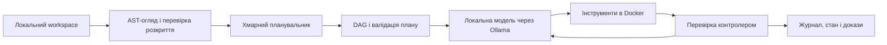

# CloudEdge AI Orchestrator

**Cloud–Edge Multi-Agent Orchestration Framework for Autonomous Development,
Research and Independent Verification.**

Гібридна система: хмарна модель планує роботу, локальна модель через Ollama
редагує файли й виконує задачі, а контролер перевіряє результат. Підтримувані
бекенди хмарного планувальника: Claude CLI, OpenAI Codex CLI та Google Antigravity
CLI. Для Paper I локальним виконавцем була `gemma4:12b`.

Попередня назва — **Antigravity Codex Orchestrator**. Python-модуль
`antigravity_hybrid_orchestrator`, старі CLI-псевдоніми та дослідницькі snapshot
збережені. Назви продуктів позначають бекенди, а не спонсорство чи схвалення.

## Scientific Publications & Reproducibility

**Paper I — Beyond Passing Tests: An Interface-Only Specification Review Cuts
Silent Failures of a Local Gemma Coding Agent.** Oleksandr Pylypenko, 2026.

- [English PDF](docs/paper/Beyond_Passing_Tests_Pylypenko_2026_EN.pdf) · [Український PDF](docs/paper/article-uk.pdf).
- [Стаття, дані, ліцензії та відтворення](docs/paper/README.md).
- [Оригінальний snapshot](https://github.com/cyberdid/cloud-edge-ai-orchestrator/tree/paper-i-preprint-2026-10-21) — commit `8e9ba05ebbbcaf7953a8f31287d935f01fa2d6be`, без змін.
- [Редакція 2](https://github.com/cyberdid/cloud-edge-ai-orchestrator/tree/paper-i-preprint-2026-10-21-rev2) — узгоджені назва, ліцензії, встановлення та CI.
- [Карта експериментальних артефактів](benchmarks/README.md), [CITATION.cff](CITATION.cff) і [контрольні суми](docs/paper/SHA256SUMS).

У сукупному аналізі **post hoc** контрактні тести зменшили приховані хибні успіхи
з 37/150 до 4/150; перевірене виконання зросло з 99/150 до 131/150. У Campaign A
checklist і контрактні тести мали однаковий сукупний результат (71/75), але
еквівалентність не встановлена, а основний зареєстрований тест не досяг значущості
(`p=0.125`). Повна вартість часу кампанії з генерацією: +11.8% для checklist і
+53.7% для тестів. Обмеження та аналіз спільних специфікацій наведені в статті.

Відтворення зі **збережених даних**, без GPU, Ollama чи хмарних викликів:

```bash
uv sync --locked --extra paper
sha256sum -c docs/paper/SHA256SUMS
uv run --locked --extra paper bash scripts/paper/reproduce.sh
```

Потрібен Tectonic 0.15.0 на `PATH`; перша компіляція може завантажити ресурси TeX.
Контрольні суми стосуються розповсюджуваних файлів **до** повторного збирання:
час створення PDF може змінити їхні байти. Повторний аналіз даних не є незалежною
реплікацією поведінки моделей. Архівний DOI ще не присвоєний.

## Швидкий старт

### 1. Встановлення

Python **3.12+**, Git і [uv](https://docs.astral.sh/uv/).

```bash
git clone https://github.com/cyberdid/cloud-edge-ai-orchestrator.git
cd cloud-edge-ai-orchestrator
uv sync --locked
uv run --locked cloud-edge-ai --help
```

Для наукового середовища або повного набору локальних тестів:

```bash
uv sync --locked --extra research --extra paper
```

`research` містить версії NumPy, SciPy, scikit-learn і psutil, узгоджені з
контейнерним дослідницьким середовищем; `paper` — matplotlib. `uv sync` узгоджує
середовище з вибраними extras: якщо пакети вже встановлені вручну, збережіть свій
набір extras або використайте окреме середовище.

### 2. Офлайн-приклад із mock-виконавцями

```bash
mkdir -p /tmp/cloudedge-demo
uv run --locked cloud-edge-ai --mode mock --no-hud \
  --workspace /tmp/cloudedge-demo --goal "Implement an add function"
```

Mock-режим використовує фікстури, не викликає моделей і не потребує Docker.
Він перевіряє механіку оркестрації, а не якість моделі.

### 3. Підготовка live-режиму

Потрібні:

- запущений Ollama з локальною моделлю (`OLLAMA_MODEL`, у дослідженні `gemma4:12b`);
- встановлений та авторизований CLI обраного хмарного бекенду;
- Docker Engine з доступом користувача до локального daemon;
- локально побудований образ для виконання задач.

```bash
docker build -f Dockerfile.orion -t antigravity-orion:local .
mkdir -p /tmp/cloudedge-live
uv run --locked cloud-edge-ai --mode live --architect agy \
  --worker-model gemma4:12b --sandbox docker \
  --workspace /tmp/cloudedge-live \
  --max-runtime 1200 --max-remote-tokens 100000 \
  --goal "Inspect the workspace and implement the requested change"
```

Хмарні й локальні модельні виклики можуть споживати квоту та ресурси; наведений
live-приклад є шаблоном задачі, а не повтором Paper I. Типовий планувальник —
`--architect haiku`; `luna` обирає Codex CLI, `agy` — Antigravity CLI. Модель
планувальника можна явно задати через `--architect-model`.

### Сумісність і додаткові режими

Публічна команда — `cloud-edge-ai`. Збережено `antigravity-codex-orchestrator`
і `codex-orchestrator`; працюють також `python -m antigravity_hybrid_orchestrator.cli`
та `./run.sh`. Назву внутрішнього модуля не змінено.

```bash
# Послідовні задачі в одній інтерактивній сесії
uv run --locked cloud-edge-ai --interactive --workspace /tmp/cloudedge-live

# Відтворення запису без модельних викликів
uv run --locked cloud-edge-ai --replay /path/to/run.jsonl --replay-speed 0 --no-hud

# Продовження збереженого live-прогону
uv run --locked cloud-edge-ai --resume /path/to/run.jsonl
```

## Архітектура та межі



- **Планування:** DAG залежностей, перевірка шляхів і команд верифікації.
- **Виконання:** локальні інструменти читання/зміни файлів, повторні спроби,
  контроль контексту, дедлайни, бюджети й виявлення зациклення.
- **Записи:** `.antigravity_runs/` зі станом, подіями та replay/resume.
- **Дослідження:** Research Integrity Evaluator і незалежні перевірки артефактів.
- **Paper I:** окремі benchmark-політики генерують контрактні тести або checklist;
  це не автоматично ввімкнена функція кожного запуску CLI.

### Privacy-bounded specification disclosure

AST-огляд вилучає реалізації функцій перед штатним передаванням у хмару.
Імена, сигнатури, docstrings і поля типів усе одно можуть розкривати інформацію.
Це **обмежене розкриття специфікації**, а не криптографічна zero-knowledge гарантія.
`--cloud-assist spec` окремо дозволяє передавання обмеженого опису помилки;
за замовчуванням `--cloud-assist off`. Порожній cwd хмарного CLI та інструкція
не використовувати tools самі по собі не є ізоляцією процесу.

### Docker за замовчуванням у live-режимі

Команди кандидата працюють без мережі, зі скинутими capabilities, `no-new-privileges`,
непривілейованим UID, read-only коренем образу та обмеженнями CPU/RAM/PID.
Образ не завантажується автоматично (`--pull=never`); при помилці немає автоматичного
переходу на host. Явний `--sandbox host` виконує команди на машині користувача.

Docker розділяє ядро з хостом; writable workspace доступний кандидату, а загальної
дискової квоти для bind mount немає. Контракти, приховані відповіді, докази та секрети
мають зберігатися за межами цього workspace. Деталі: [модель загроз](docs/SECURITY_MODEL.md).
Дослідницькі benchmark-скрипти мають власні правила виконання: їх не слід вважати
ізольованими лише через стандартний режим основного CLI.

## Перевірки та CI

```bash
uv lock --check
uv run --locked --extra research pytest -q tests temp/project_orion/tests

# Реальні Docker acceptance-перевірки, після побудови образу
RUN_DOCKER_TESTS=1 uv run --locked --extra research pytest -q tests/test_sandbox.py
```

Актуальну кількість і результат повідомляє pytest/CI; статичне число тестів у README
не підтримується. [GitHub Actions](.github/workflows/ci.yml) запускає наявний офлайн-набір,
Docker acceptance та відтворення наукових підсумків/PDF без моделей. Поточний GitHub-hosted запуск заблокований обмеженням акаунта ще до кроків jobs; локальні перевірки виконані. [Статус першого запуску](https://github.com/cyberdid/cloud-edge-ai-orchestrator/actions/runs/39614615645).

## Структура

| Шлях | Призначення |
|---|---|
| `antigravity_hybrid_orchestrator/` | Публічний framework зі збереженим Python namespace |
| `tests/` | Модульні та інтеграційні перевірки |
| `scripts/` | Дослідницькі runner-и, аналіз і відтворення |
| `benchmarks/` | Канонічні результати, checkpoints і діагностичні журнали |
| `docs/paper/` | Двомовна стаття, джерела, рисунки та SHA-256 |
| `temp/project_orion/` | Історичний дослідницький проєкт Orion |
| `Dockerfile.orion` | Контейнерне середовище кандидата |

## Ліцензії та цитування

Код — [Apache-2.0](LICENSE). Стаття й експериментальні записи —
[CC BY 4.0](docs/paper/LICENSE), за [описом меж ліцензування](docs/LICENSING.md).
Сторонні залежності, моделі та цитовані роботи мають власні умови.
Використовуйте [CITATION.cff](CITATION.cff) та конкретний commit/tag дослідження.
Історичні snapshot не переписуються для зміни назви, ліцензії чи метаданих.
