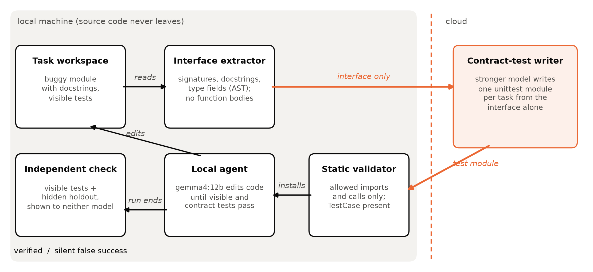
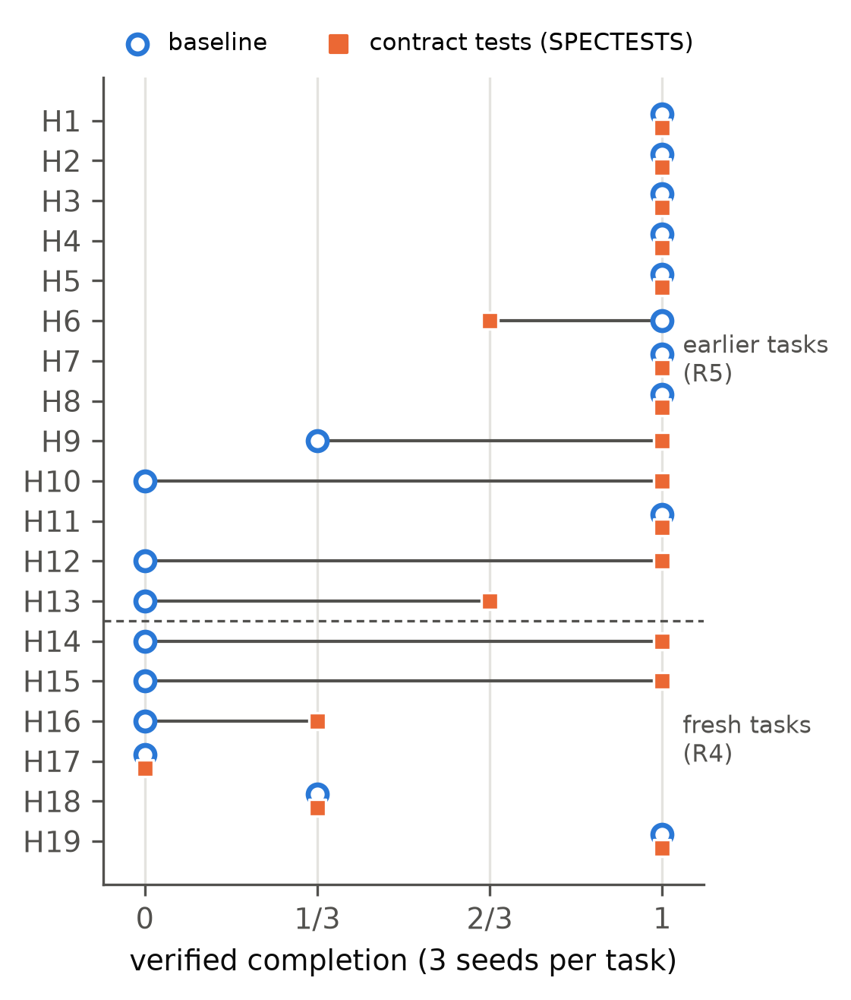
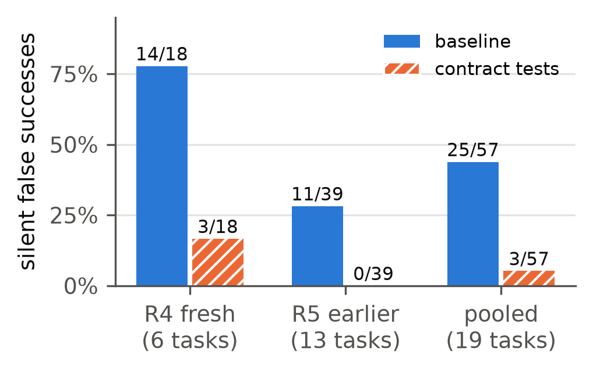
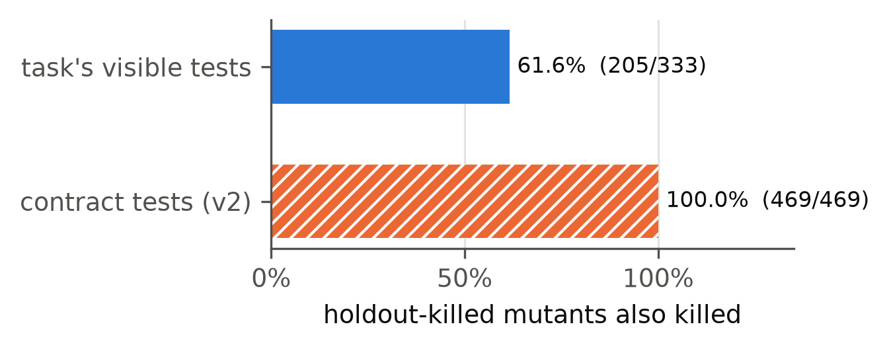
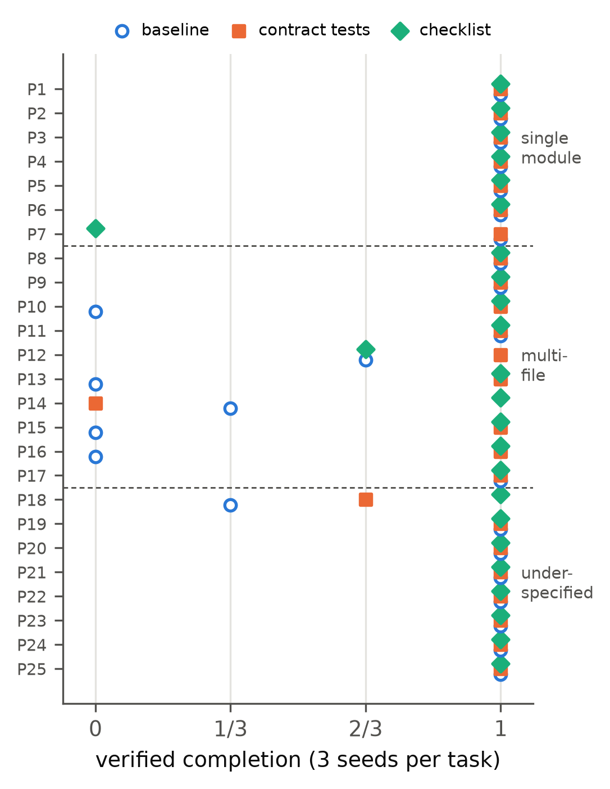

> **Draft.** Results of the pre-registered Campaign A (`docs/paper/PREREGISTRATION_CAMPAIGN_A.md`) are pending; this version reports the exploratory study and one pre-registered confirmatory run. Every number is bound to an evidence ID in `docs/paper/sources.md`.

# Beyond Passing Tests: Interface-Only Specification Checks Against Silent Failures of a Local Gemma Coding Agent

**Oleksandr Pylypenko** (Researcher) — ORCID [0009-0004-9610-9242](https://orcid.org/0009-0004-9610-9242)

## Abstract

Coding agents are usually judged by whether they make the available tests pass. We study the architect–builder arrangement that Google introduced for local models in the Antigravity SDK — a cloud Gemini model plans, a local Gemma model edits [R8] — with a local 12-billion-parameter builder (`gemma4:12b`, run on a consumer laptop GPU) that repairs small Python modules whose docstrings state more rules than the visible tests check. The agent often makes the visible tests pass, reports success, and violates a rule that only the docstring states — a *silent false success*. We evaluate a privacy-bounded division of labour: a cloud model receives only the interface of the code under repair — signatures, docstrings and data-type fields, never function bodies — and writes a unit-test module (*contract tests*) that the local agent must also satisfy; acceptance is decided by an independent hidden evaluation that neither model sees. Across 19 tasks and three seeds per task, verified completion rose from 32/57 to 48/57 runs and silent false successes fell from 25/57 to 3/57 [E5, E6]. Treating the task rather than the run as the unit of inference, 7 tasks improved and 1 worsened (sign-flip permutation p = 0.023; mean gain in verified rate +0.28, cluster-bootstrap 95% CI 0.09–0.49) [E7]; a pre-registered run on six fresh tasks was significant at run level (p = 0.039) but not at task level (3 improved, 0 worsened, p = 0.25) [E5, E7]. The tests must see the full interface: without data-type fields, the cloud wrote impossible tests that turned solved tasks into failures (6 losses, 0 wins, p = 0.031) [E3]. With the full interface, no over-constrained test was found on 47 independent valid implementations, and the contract tests killed every mutant the hidden evaluation killed, against 61.6% for the visible tests [E8]. Self-checking by the same local model, cloud guidance after failure, larger generation limits and one-step harness adaptation did not help [E2, E9, E10]. The gain costs at least 1.7–4.3× wall time [E5, E6]. The effect is concentrated in tasks whose rules live only in the docstring; whether it holds on naturally occurring bugs is the question for the planned confirmatory campaign.

## 1. Introduction

A passing test suite is the usual stopping criterion for an autonomous coding agent. It is also a weak one: when tests cover only part of the specification, an agent can satisfy the tests while violating the rest. Benchmark studies have shown that insufficient tests overstate the correctness of generated code — extending HumanEval's tests reduced pass@k by up to 19.3–28.9% across 26 models [R3]. For an agent that works unattended, the failure is worse than a visible error: the agent reports success, and nothing downstream objects.

We met this failure while building a hybrid orchestrator in which a cloud "architect" plans and a local model does the editing, so that source code stays on the machine. This is the arrangement Google introduced for local models in the Antigravity SDK: a cloud Gemini model plans from file names and descriptions alone, while local Gemma instances do the work on the device [R8]. With a 12B local worker, the dominant failure on specification-heavy repair tasks was not inability to edit code or to follow a plan: the worker made the visible tests pass and silently missed rules stated only in the docstring [E1, E2]. Generation-limit escalation, thinking on retry, cloud guidance after a failed attempt and one-step harness adaptation did not change that [E9, E10].

This paper asks a narrow question: **can tests written by a cloud model from the specification alone reduce silent failures of a local coding agent, without sending the implementation to the cloud, and at what cost?** Our contributions are:

1. A measurement of silent false successes of a local coding agent on specification-heavy repair tasks, with an independent hidden evaluation as ground truth.
2. A privacy-bounded mechanism in which the cloud sees signatures, docstrings and data-type fields only, with evidence that interface completeness decides whether contract tests help or harm.
3. A pre-registered campaign with a checklist control, showing that the improvement comes from an independent reading of the specification rather than from making it executable, and a procedure (seeded rule visibility; bugs written by the local model) that keeps the author from choosing where the method can help.
4. An evaluation that separates run-level from task-level inference, reports negative results for five alternative interventions, and checks the generated tests for over-constraint and mutation coverage without involving the agent.

We do not claim that generating tests with language models is new (Section 2), nor that the effect generalises beyond the task family studied here (Section 8).

## 2. Related work

**Insufficient tests.** EvalPlus extended HumanEval's test inputs about 80-fold with LLM- and mutation-based generation and found many solutions previously counted as correct to be wrong [R3]. Our hidden evaluations play the role of the stronger tests; our concern is the agent's own stopping criterion rather than benchmark scoring.

**Tests generated by language models.** CodeT generates tests with the same model that writes candidate solutions and ranks the solutions by agreement with those tests [R4]. AgentCoder separates a programmer agent from a test-designer agent that writes tests from the requirements [R5]. TestGen-LLM at Meta improves existing human-written test classes and keeps only candidates that pass filters for measurable improvement; in deployment 75% of its test cases built correctly, 57% passed reliably and 25% increased coverage [R2]. Closest to our setting, spec-driven test generation at Google first derives pre-conditions, post-conditions and undefined behaviour and then writes tests from them, improving bug detection on production bugs by 9.8 percentage points (p = 0.0352) [R1]. Our mechanism differs in where information flows: the test writer is a *different, remote* model that never sees function bodies, and the tests act as an acceptance gate for a *local* agent rather than as a test-suite product.

**Agents that game tests.** ImpossibleBench modifies tests so that they contradict the natural-language specification and measures how often agents nevertheless make them pass [R6]. Our failure mode is complementary: the agent does not manipulate tests; it stops when the visible tests pass and leaves unstated-in-tests rules unimplemented.

**Harness adaptation.** Harness² adapts an agent's harness — prompts, procedures, tools — without changing model weights [R7]. A one-step adaptation of our worker in this style did not improve held-out tasks (Section 6.7).

## 3. Problem and metrics

A task consists of a buggy module whose functions carry docstring specifications, a visible unit-test file, and a hidden evaluation that checks docstring rules the visible tests omit. For one run of the agent let V ∈ {0, 1} indicate that the task's own visible tests pass after the run, H ∈ {0, 1} that the hidden evaluation passes, and S ∈ {0, 1} that the agent reports success.

- **Verified completion** (primary): V = 1 ∧ H = 1.
- **Silent false success:** S = 1 ∧ (V = 0 ∨ H = 0); in practice almost always V = 1, H = 0.
- **Cost:** wall time of the agent run, local tokens and cloud tokens. The one-time generation of contract tests per task was counted in tokens but not timed in the runs reported here (Section 6.6).

V and H are evaluated after the run by the benchmark, on the task's own test modules only — generated contract tests are excluded — and the hidden evaluation is never shown to either model [E4].

## 4. System

**Local agent.** `gemma4:12b` served by Ollama 0.33.3 (model digest `4eb23ef187e2…`), with native tool calling over a workspace tool suite (read, write, patch files; run the verification command), `think` off, 16,384-token context, a generation limit of 2,048 tokens raised to 4,096 for one retry when a tool call is truncated, stage hints that name the next step and the failing test, and a self-correction loop of up to two attempts with a 300 s deadline per attempt [E4, E11]. Hardware: one NVIDIA GeForce RTX 4060 Laptop GPU (8 GB), 31 GB RAM; the model is partly offloaded to the CPU [E11].

**Interface payload.** For the files the subtask may modify, plus the non-test input modules they use, an AST pass emits class names, function signatures, docstrings and annotated class fields (names and types; defaults dropped). Function bodies and all other source are omitted, and the payload passes the orchestrator's privacy verifier before it leaves the machine [E12].

**Contract-test writer.** The cloud model receives the payload and an instruction to write one `unittest` module that checks every rule the docstrings state — results for representative and edge inputs and `ValueError` for each kind of invalid input described — and to test nothing the docstrings do not state [E12]. The returned module is statically validated (imports limited to `unittest` and the modules under test; no `open`, `exec`, `eval`, `getattr` and similar calls; no dunder attributes; a `TestCase` subclass present) and, if valid, written next to the task's own tests as `test_spec_contract.py`, where the agent's normal verification command discovers it. Tests are generated once per task and reused across seeds. The cloud backend was the Antigravity CLI (`agy` 1.4.3) with its default model, run in an empty temporary directory and instructed not to use tools [E12, E13]. The model behind the CLI's default setting was not recorded in these runs; Campaign A pins it explicitly.

**Privacy boundary.** Names, types and docstrings can themselves disclose information; we describe the mechanism as *privacy-bounded specification disclosure*, not as a formal privacy guarantee.

**Figure 1.** Information flow. Only the interface (signatures, docstrings, data-type fields) crosses the boundary to the cloud, and only a statically validated unit-test module comes back; the agent edits the code locally until its visible tests and the contract tests pass. Acceptance is decided after the run by the task's own visible tests and a hidden holdout that neither model sees. Script `scripts/analysis/paper_diagram.py` [E12, E14].

## 5. Experimental design

All runs use the same agent loop, deadline and attempt limit in each arm, three seeds (303, 404, 505) per task, and alternate the order of arms per seed [E4]. Tasks are small Python repair tasks (one or two modules) in which the visible tests cover only part of the docstring; each was checked offline so that the original code and partial fixes fail and only a complete fix passes both visible and hidden checks [E1].

The evidence was collected in five runs (Table 1). Runs R1–R3 were exploratory; between R3 and R4 a measurement error was found and corrected (Section 6.6); R4 was pre-registered; R5 repeats R3's comparison with the corrected measurement.

**Table 1. Runs.**

| Run | Commit | Tasks | Arms | Purpose |
|---|---|---|---|---|
| R1 | `cc938ca` | H6, H9–H13 (6) | baseline, SPEC, SPECTESTS, ASSIST | exploratory comparison [E1] |
| R2 | `24fbe35` | H1–H5, H7, H8 (7) | baseline, SPECTESTS v1 | harm on solved tasks [E3] |
| R3 | `750647e` | H1–H13 (13) | baseline, SPECTESTS v2 | same-session comparison [E3] |
| R4 | `7a369ac` | H14–H19 (6, fresh) | baseline, SPECTESTS v2 | pre-registered confirmation [E5] |
| R5 | `7a369ac` / `2c59e38` | H1–H13 (13) | baseline, SPECTESTS v2 | corrected-measurement repeat [E6] |

*Baseline* is the agent with stage hints and adaptive generation limit. *SPEC* gives the agent its own task's signatures and docstrings after the visible tests pass and requires one self-check of every rule. *SPECTESTS* installs cloud contract tests before the run (v1: functions' own file only; v2: plus data-type fields and dependent modules). *ASSIST* asks the cloud for step-by-step guidance after a failed attempt. Between R3 and R4 a change was made for both arms: a single stall within an attempt now leads to a fresh attempt instead of ending the subtask [E5].

**Pre-registration (R4).** Before any run on H14–H19 the primary endpoint (verified completion), arms, seeds, attempt limit, pairing by (task, seed) and an exact two-sided sign test were written in the project's run ledger [E5]. The ledger is a local file outside version control, so the registration is not independently time-stamped (Section 8). A first attempt of R4 crashed on a hang and used the uncorrected measurement; it was discarded and rerun unchanged except for the measurement fix [E5].

**Statistics.** Run-level comparisons use exact two-sided sign tests on discordant (task, seed) pairs. Because runs of one task are not independent, we also analyse the per-task difference in verified rate (SPECTESTS minus baseline, over three seeds): task-level sign test, exact sign-flip permutation test and a cluster bootstrap over tasks (20,000 resamples) [E7]. The task-level analysis was added after an external review and is post hoc with respect to R4.

**Confirmatory campaigns A and B.** To address the threats of Section 8 — tasks and bugs written by the author after the failure mode was known, too few unseen tasks, an unrecorded cloud model and no control for the cloud's reading of the specification — two further campaigns were registered publicly before they were run [E15, E16].

- *Tasks.* Twenty-five new repair tasks (P1–P25: 8 single-module, 10 multi-file, 7 with deliberately brief, under-specified docstrings) from domains not used before (money, text, dates, units, scheduling, statistics, configuration, matrices, rate limiting, formatting). Each docstring states numbered rules, and each rule has test cases. **Which rules the visible tests cover is not chosen by the author:** a seeded coin flip per rule (p = 0.5) decides, constrained only so that at least one visible rule fails on the buggy code. The hidden holdout checks every rule. Task content is frozen with a SHA-256 per task [E17].
- *Bugs.* In Campaign A the buggy code is written by the author. In Campaign B it is written by the local model itself: for each specification, `gemma4:12b` implements the editable module from its docstring skeleton (generation seeds 1–5, temperature 0.8, no tests shown); the original docstrings are restored so that the defect lies only in function bodies, and the first implementation that breaks a rule becomes the task. Specifications the model implements correctly on every seed are excluded and counted [E16].
- *Arms.* Baseline; contract tests; and a **checklist control** in which the same cloud model receives the same interface and returns a numbered list of rules that is appended to the task description instead of tests. The control separates the effect of executable tests from the effect of a stronger model reading the specification. Campaign A adds an exploratory ablation of how much interface the cloud sees (signatures only; plus docstrings; full) [E15].
- *Settings.* As in R4–R5, with the cloud model pinned (`gemini-4-argon-medium` via the Antigravity CLI) and the one-time generation time recorded per task. Seeds 303, 404, 505. Primary test: exact two-sided sign test over tasks on the per-task verified rate (contract tests vs baseline); secondary: silent false successes, contract tests vs checklist, results by category, cost [E15, E16].

## 6. Results

### 6.1 Exploratory comparison (R1)

On six specification-heavy tasks, verified completion was 7/18 for the baseline, 5/18 with local self-checks (SPEC), 16/18 with contract tests (SPECTESTS) and 8/18 with guidance after failure (ASSIST); SPECTESTS versus baseline gave 10 wins and 1 loss (run-level p = 0.012) [E1]. Runs that passed the visible tests but failed the hidden evaluation numbered 11 for the baseline, 10 for SPEC, 0 for SPECTESTS and 10 for ASSIST [E1]. (R1 scored the SPECTESTS arm with a stricter criterion than the baseline; Section 6.6.)

### 6.2 Interface completeness decides between help and harm (R2, R3)

On seven tasks the baseline already solves, the first version of the contract tests (v1) — written from the functions' own file only — reduced verified completion from 21/21 to 15/21 (0 wins, 6 losses, p = 0.031) [E3]. Five losses were on H1 and H3, where the data types live in other modules; grading the generated modules against reference implementations showed 19 of 20 tests wrong for H1 (a non-existent field name) and 11 of 12 for H3 (a missing constructor argument) [E3]. With data-type fields and dependent modules in the payload (v2), every generated module for the 13 tasks passed on its reference implementation, and the solved tasks lost 2 of 21 runs (not significant); on the four tasks where the baseline mostly stopped at the visible tests, verified completion rose from 2/12 to 10/12 (8 wins, 0 losses, p = 0.0078) [E3].

### 6.3 Pre-registered run on fresh tasks (R4)

On six tasks not used before, verified completion was 4/18 for the baseline and 11/18 with contract tests (8 wins, 1 loss, 9 ties; run-level p = 0.039), and silent false successes were 14/18 and 3/18 [E5]. At task level, three tasks improved (H14 0/3 → 3/3, H15 0/3 → 3/3, H16 0/3 → 1/3), none worsened and three were unchanged (H17 0/3 both, H18 1/3 both, H19 3/3 both): sign test p = 0.25, mean gain +0.39 (cluster-bootstrap 95% CI 0.06–0.72) [E5, E7]. The three remaining silent failures were all on H17; the only violated hidden rules concern empty pairs (`"a=1;;b=2"`, `"a=1;"`), a reading of the docstring that is arguably ambiguous; grading H17 without those two cases gave 7/18 versus 14/18 with the same 8 wins and 1 loss [E5]. All six generated modules passed on independent reference implementations [E5].

### 6.4 All 19 tasks with corrected measurement (R4 + R5)

R5 repeated the R3 comparison on H1–H13 with the corrected measurement: 28/39 versus 37/39 (10 wins, 1 loss, run-level p = 0.012), silent false successes 11/39 versus 0/39, and 26 of 27 SPECTESTS runs verified on the nine tasks the baseline solves 3/3 (one H6 loss) [E6]. R5 was interrupted after 36 of 78 runs by a planned shutdown and resumed from its saved results with the same generated tests [E6]. Pooled over R4 and R5 (19 tasks, identical engine and checks): verified completion 32/57 versus 48/57, silent false successes 25/57 versus 3/57 [E5, E6]. Table 2 and Figure 2 give the task-level picture; Figure 3 shows silent false successes.

**Table 2. Task-level analysis (unit = task; difference in verified rate over three seeds) [E7].**

| Set | Better / worse / equal | Sign test | Sign-flip permutation | Mean gain (95% cluster-bootstrap CI) |
|---|---|---:|---:|---|
| Fresh H14–H19 (R4) | 3 / 0 / 3 | 0.25 | 0.25 | +0.39 (0.06, 0.72) |
| H1–H13 (R5) | 4 / 1 / 8 | 0.38 | 0.13 | +0.23 (0.03, 0.46) |
| All 19 tasks | 7 / 1 / 11 | 0.070 | 0.023 | +0.28 (0.09, 0.49) |

The gain is concentrated in seven tasks whose rules are stated only in docstrings (H9, H10, H12, H13, H14, H15, H16); eleven tasks are unchanged and one (H6) lost one of three runs [E7].

**Figure 2.** Verified completion per task (three seeds) for the baseline (open circles) and with contract tests (filled squares); lines join the two arms where they differ. Tasks below the dashed line are the fresh tasks of the pre-registered run R4; tasks above are from R5. Data: E5, E6; script `scripts/analysis/paper_figures.py` [E14].

**Figure 3.** Silent false successes — the agent reports success but the independent check fails — per run and pooled. Data: E5, E6 [E14].

### 6.5 Quality of the generated tests

The generated tests were examined without the agent [E8]. **Over-constraint.** Forty-seven distinct implementations that passed both the visible tests and the hidden evaluation in runs *without* contract tests were reconstructed from recorded diffs (initial-state hashes checked) and run against the v2 contract modules: 6 of 91 implementation–module pairs failed, all on H4 (a negative weight must raise) and H9 (a `+` sign or a non-ASCII prerelease character must be rejected). In each case the docstring states the rule and the implementation violates it; the hidden evaluation does not test it. We found no contract test that requires behaviour the docstring does not state. **Mutation coverage.** Of 448 single-point AST mutants of reference implementations (19 tasks), the hidden evaluation killed 333; of those, the visible tests killed 205 (61.6%) and the v2 contract modules killed all (469 of 469 mutant–module pairs). (Figure 4.) A further 84 mutants survived the hidden evaluation but were killed by contract tests; each violates a docstring rule on inspection. Thirty-one mutants survived every check. For H14–H16 the reference was a holdout-passing implementation from a SPECTESTS run, because no baseline run solved those tasks. A consequence is that the hidden evaluations are weaker than the specifications, so "verified" overstates correctness in both arms; since the contract tests enforce the missed rules, this bias favours the baseline.

**Figure 4.** Of the single-point mutants that the hidden evaluation kills, the share also killed by the task's visible tests and by the v2 contract tests (contract counts are mutant–module pairs). Data: E8 [E14].

### 6.6 Measurement correction and cost

In R1–R3 the independent visible check for the SPECTESTS arm also ran the generated tests, and the hidden evaluation ran only if that check passed; SPECTESTS runs were therefore scored against a stricter criterion than baseline runs, which can only have lowered their scores [E4]. R4 and R5 use the corrected checks (task's own tests only, hidden evaluation always run, hangs counted as failures) [E4].

Contract tests make runs longer: in R4 the summed wall time was 929 s versus 4,014 s and local tokens 256,017 versus 1,171,194, plus 91,958 cloud tokens for six generation calls; in R5, 3,092 s versus 5,273 s and 614,904 versus 1,378,211 local tokens, plus about 264,000 cloud tokens for 13 tasks [E5, E6]. The baseline is fast partly because it stops as soon as the weak visible tests pass. The wall-time figures exclude the one-time cloud generation per task, which was not timed; the reported ratios (1.7–4.3×) are lower bounds on end-to-end cost [E7]. The benchmark now records generation time separately.

### 6.7 Interventions that did not help

- **Self-checking by the same model** (SPEC, R1): 5/18 versus 7/18; the agent's self-checks exercised only behaviour it had already implemented [E1].
- **Cloud guidance after failure** (ASSIST, R1): 8/18; guidance is triggered by a failed attempt, and the first attempt usually passed the visible tests, so it triggered once in 18 runs [E1].
- **Escalation of generation limit, thinking on retry and cloud assistance** in a two-attempt ladder: on H6–H8 the differences came from one task and were attributed to run-to-run variation [E9].
- **One-step harness adaptation** in the style of Harness²: on held-out tasks the default harness verified 7/12 runs and the adapted harnesses 6/12, with longer total wall time (829 s versus 601 s); the standard and verifier-gated promotion rules made the same choices on every task, so the experiment does not distinguish them [E10].

### 6.8 Campaign A: 25 new tasks with seeded rule visibility (pre-registered)

All 225 primary runs were completed (3 arms × 25 tasks × 3 seeds) [E18]. The campaign was paused twice at the author's request and resumed from saved results with the same generated tests and checklists; nothing else changed. Each of the 25 test modules and 25 checklists was generated once with Gemini 4 Argon and reused across seeds.

**Table 3. Campaign A, all runs [E18].**

| Arm | Verified | Silent false successes | Run wall time (sum) | One-time generation | Cloud tokens |
|---|---:|---:|---:|---:|---:|
| Baseline | 58/75 | 9/75 | 6,675 s | — | 0 |
| Contract tests | 71/75 | 1/75 | 9,630 s | 626 s | 627,787 |
| Checklist (control) | 71/75 | 1/75 | 6,983 s | 477 s | 550,901 |

**Figure 5.** Campaign A: verified completion per task (three seeds) for the baseline (open circles), contract tests (squares) and the checklist control (diamonds). Dashed lines separate single-module, multi-file and under-specified tasks. Data: E18 [E14].

**Primary hypothesis (H1) not confirmed.** At task level, contract tests improved 6 tasks and worsened 1 (18 unchanged): sign test p = 0.125, sign-flip permutation p = 0.0625, mean gain in verified rate +0.17 (cluster-bootstrap 95% CI 0.04–0.33) [E18]. The direction matches the earlier runs, but the registered test does not reach α = 0.05. The fall in silent false successes (H2) was 3 tasks lower and none higher (p = 0.25).

**Contract tests did no better than the checklist (H3).** The checklist control — the same cloud model reading the same interface, returning a list of rules instead of tests — produced the same totals (71/75 verified, 1/75 silent) and the same task-level picture (contract tests vs checklist: 2 better, 2 worse, 21 equal; p = 1.0). In this campaign the benefit came from a stronger model reading the specification, not from making it executable.

**Where the effect sits.** All changes are in the 10 multi-file tasks (6 better, 1 worse; mean +0.43). On the 8 single-module and 7 under-specified tasks the baseline was already verified in every run, so there was nothing to gain; no task without hidden failing rules was harmed.

**Failures of the two cloud arms (forensics).** P14 with contract tests failed 3/3 by running out of attempts while the (correct) contract tests still failed; P7 with the checklist failed 3/3 the same way after the checklist spelled out the quoting rules of CSV; both are explicit failures. For P18 both generated test modules were rejected by the static validator (they used `__dict__`), so the contract-test arm ran without tests on that task, as registered.

**Quality of the generated tests.** Run against the reference fixes, 4 tests in 3 of the 24 installed modules failed [E19]: three are over-constrained — on the under-specified P20 they require `ValueError` for an empty list and a float result, and on P12 a test requires the delegation to `statcore.mean` to be visible to monkey-patching, which depends on the import style rather than behaviour; the fourth (P10) expects `0.0` as a float where the docstring says 0.0 and the reference returns the integer 0. None of these tests caused a failed run (P12 and P20 were verified in all contract-test runs).

**How much interface the cloud needs (exploratory ablation, seed 303 only).** With signatures alone, contract tests left verified completion at the baseline level (19/25, 2 silent; baseline 20/25 on this seed); adding docstrings gave 25/25 (0 silent); the full interface with type fields gave 23/25 (1 silent) [E18]. On these tasks the value lies in the docstrings; type fields added nothing here, whereas on the earlier tasks H1 and H3, whose data types live in separate modules, their absence produced impossible tests (Section 6.2). One seed per level, so differences of one or two runs are within run-to-run variation.

**Cost.** Contract tests lengthened runs by 44% (9,630 s vs 6,675 s) plus 25 s of generation per task; the checklist by 5% plus 19 s per task. With the cloud model pinned, the end-to-end overhead is far below the 1.7–4.3× measured in R4–R5 with the CLI's default model.

### 6.9 Campaign B: bugs written by the local model (pre-registered; descriptive)

**Construction.** Asked to implement each of the 25 Campaign A specifications from its docstring skeleton, `gemma4:12b` produced a correct module on all five generation seeds for 19 specifications (104 generations; one rejected as incomplete) [E20]. Only six specifications yielded a natural bug (N1, N7, N8, N9, N13, N18), fewer than the registered threshold of ten, so Campaign B is reported descriptively, as registered. In four of the six the coin flip made every broken rule visible; only N7 and N18 have rules broken in hidden-only form. With numbered rules in the docstring, the local model rarely leaves a stated rule unimplemented when it writes the code from scratch; the silent failures of the earlier tasks arose when it repaired code against incomplete tests.

## 7. Discussion

**What the agent lacked.** On these tasks the local agent's binding constraint was the coverage of its stopping criterion, not its ability to write code: it stopped when the visible tests passed and left rules stated only in the docstring unimplemented. Every intervention that helped changed what "done" meant for the agent; every intervention that did not — more generation budget, thinking on retry, guidance after a failed attempt, a self-check by the same model, a one-step harness edit — left the stopping criterion as it was (Section 6.7).

**What closed the gap.** The exploratory runs attributed the improvement to contract tests. The pre-registered Campaign A, with a checklist control, revises that attribution: a numbered list of the stated rules, written by the same cloud model from the same interface and simply appended to the task, produced the same verified completion (71/75) and the same fall in silent false successes (9/75 to 1/75) as executable tests, at a fraction of the cost (5% against 44% more run time). The active ingredient is an independent reading of the specification by a stronger model, which turns rules that are implicit for the agent into explicit items; making those items executable added nothing measurable here. Independence and strength both matter: the same local model checking itself did not help (Section 6.7). Tests keep two properties a checklist lacks — they can be audited (here they killed every mutant the hidden evaluation killed) and they enforce the rules without relying on the agent to read them — but in Campaign A neither showed up in the outcomes.

**What the cloud must see.** The value lies in the docstrings: with signatures alone the cloud did not help (Section 6.8). When the data types a function uses live in other modules, the cloud must see their fields too, or it writes tests that cannot pass and turns solved tasks into failures (Section 6.2). Under-specified docstrings invite tests of unstated behaviour; in our runs these over-constrained tests did no harm, but they are a risk wherever the unstated behaviour matters.

**Where it helps.** The effect is not uniform. On single-module tasks with numbered rules the baseline was already verified in every Campaign A run, and when asked to write those modules from scratch the local model implemented the stated rules correctly for 19 of 25 specifications (Section 6.9). The gains are concentrated in tasks whose rules span modules or are stated only in docstrings the visible tests do not exercise. A practical system would request a specification review only there, and the checklist is the cheaper form.

**Strength of the evidence.** The direction of the effect is the same in every run, but the registered task-level test of Campaign A did not reach significance (6 tasks better, 1 worse, p = 0.125): with most tasks already solved by the baseline, only seven tasks were discordant. The pooled evidence across the earlier tasks and Campaign A is suggestive rather than confirmatory, and the claims of this paper are limited accordingly.

## 8. Threats to validity

- **Task selection.** All tasks are small Python repair tasks written by the author. The 19 earlier tasks were partly written *after* the failure mode had been identified and over-represent tasks where the method helps. Campaign A reduces this bias (which rules are visible is decided by a seeded coin flip) and Campaign B takes the bugs from the local model, but the specifications themselves are still the author's, with rules stated explicitly and numbered, which makes them easier than typical real-world docstrings. The effect size on naturally occurring bugs is unknown.
- **Development reuse.** Tasks H1–H13 were used while developing the mechanism; R4 and Campaigns A and B are the runs on unseen tasks.
- **Statistical unit and power.** Seeds of one task are not independent; run-level p-values overstate generalisation to new tasks. Task-level tests for R4–R5 (Table 2) are post hoc; in Campaign A the registered task-level test was not significant, largely because the baseline already solved most tasks.
- **Pre-registration.** R4's registration lives in a local ledger outside version control and is not independently time-stamped; Campaigns A and B were registered by public commits before they ran, with one documented amendment to Campaign B (cloud model).
- **Ground truth.** Hidden evaluations are weaker than the docstrings (Section 6.5); verified rates are upper bounds for both arms.
- **Scope: one model stack.** This is a study of one stack — Gemma as the local builder, a cloud model behind the Antigravity CLI as the test writer. Google's announcement pairs Gemma 4 26B A4B with Gemini 3.8 Flash [R8]; we use the smaller `gemma4:12b`, and in Campaigns A and B Gemini 4 Argon. In R1–R5 the CLI's default model was used and not recorded, so those runs are not claimed to use Gemini. No claim is made for other model families.
- **Models and hardware.** One local model; the cloud model was unrecorded in R1–R5 and differs between Campaign A (Gemini 4 Argon) and Campaign B (Gemini 3.8 Flash), so comparisons across those campaigns are descriptive; one consumer GPU with partial CPU offload (wall time is sensitive to background load).
- **Cost accounting.** Cloud generation time is missing from R1–R5.
- **Interrupted runs.** R5 and Campaigns A and B were paused at the author's request and resumed from saved results with the same generated tests and checklists, in different sessions.

## 9. Conclusion

A local 12B coding agent working as the builder in a cloud-architect / local-builder arrangement often reports success after passing incomplete visible tests. Giving it an independent reading of the specification — produced by a stronger cloud model that sees only the interface, never the code — reduced such silent failures in every experiment we ran: from 25 of 57 to 3 of 57 runs on the earlier tasks, and from 9 of 75 to 1 of 75 in the pre-registered Campaign A. In Campaign A a plain checklist of the stated rules was as effective as executable contract tests and far cheaper, the gains came from multi-file tasks, and the registered task-level test did not reach significance. The safest reading is that the stopping criterion of a small local agent should include an independent specification review where rules span modules, and that this review need not take the form of tests.

## 10. Data and code availability

Code, task definitions, raw benchmark results and analysis scripts are in the repository `cyberdid/antigravity-codex-orchestrator`, branch `feat/gemma-orion-phase2b`. An archival snapshot with a DOI will accompany the final version.

## References

- [R1] M. Tufano, J. McClure, J. Cambronero, S. Cheng, S. Y. Shi, R. Wei, D. Chen, F. Ivancic, L. Dalloro, P. Rondon. *Grounding AI Agents in Contracts: An Empirical Evaluation of Spec-Driven Test Generation.* SpecOps '26: 1st International Workshop on Specification-Driven Development Life Cycle, ACM, 2026. https://research.google/pubs/grounding-ai-agents-in-contracts-an-empirical-evaluation-of-spec-driven-test-generation/
- [R2] N. Alshahwan, J. Chheda, A. Finegenova, B. Gokkaya, M. Harman, I. Harper, A. Marginean, S. Sengupta, E. Wang. *Automated Unit Test Improvement using Large Language Models at Meta.* FSE 2024. arXiv:2402.09171.
- [R3] J. Liu, C. S. Xia, Y. Wang, L. Zhang. *Is Your Code Generated by ChatGPT Really Correct? Rigorous Evaluation of Large Language Models for Code Generation.* NeurIPS 2023. arXiv:2305.01210.
- [R4] B. Chen, F. Zhang, A. Nguyen, D. Zan, Z. Lin, J.-G. Lou, W. Chen. *CodeT: Code Generation with Generated Tests.* ICLR 2023. arXiv:2207.10397.
- [R5] D. Huang, J. M. Zhang, M. Luck, Q. Bu, Y. Qing, H. Cui. *AgentCoder: Multi-Agent-based Code Generation with Iterative Testing and Optimisation.* arXiv:2312.13010v3, 2024.
- [R6] Z. Zhong, A. Raghunathan, N. Carlini. *ImpossibleBench: Measuring LLMs' Propensity of Exploiting Test Cases.* ICLR 2026. arXiv:2510.20270.
- [R7] Google Research. *Harness²* (software repository). https://github.com/google-research/harness2
- [R8] S. Kotwani, T. Mullen. *Introducing Support for Local AI Models in the Antigravity SDK.* Google Developers Blog, 23 September 2026. https://developers.googleblog.com/introducing-support-for-local-ai-models-in-the-antigravity-sdk/
